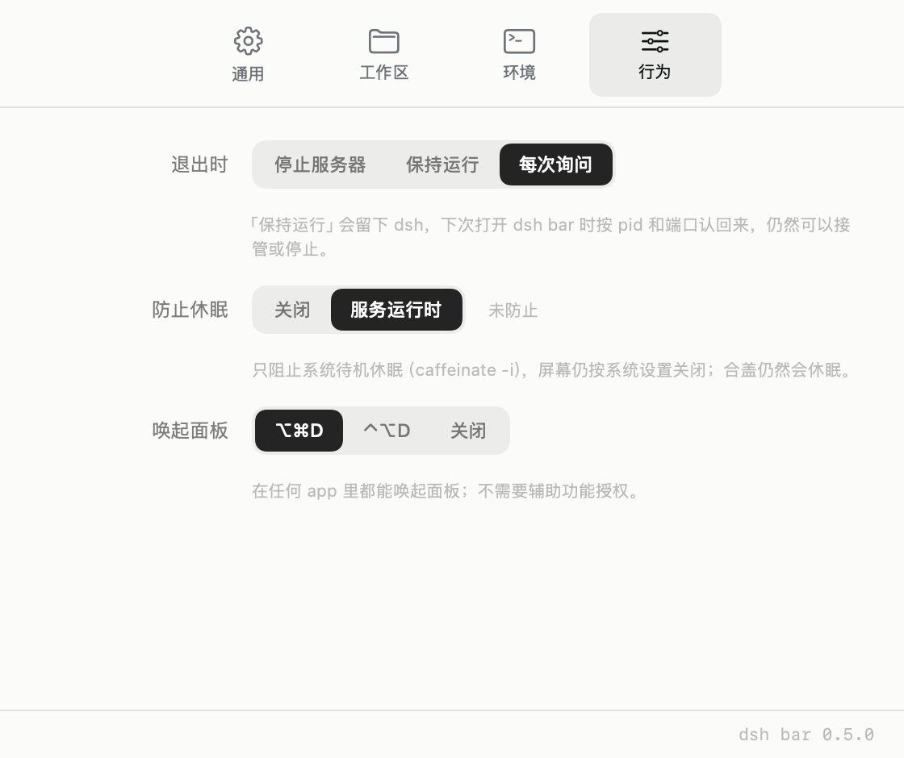

# dsh bar

macOS 菜单栏里的 dsh 管理器：把 `dsh --profile web` 挂在它下面，用面板启动 / 停止 / 重启，一键进入网页界面。服务在监听时，机器不进待机休眠，屏幕照常关闭。

**0.5.0。** 面板上的每个状态都来自一个真实的 `dsh --profile web` 进程。取舍在 [round-3](docs/plan/round-3.md) / [round-4](docs/plan/round-4.md)，细节在[实现笔记](docs/notes/implementation-notes.md)。


## 状态

| 状态 | 状态词 | 动作 |
|---|---|---|
| 未找到 dsh | `未找到 dsh` | 选择 dsh 可执行文件… |
| 未运行 | `未运行` | 启动 |
| 启动中 | `正在启动…` | 取消 |
| 正在监听 | `正在监听` | 打开网页界面 / 停止 / 重新启动 / 复制链接 |
| 外部启动 | `正在监听` | 在浏览器中打开 / 接管（二次确认）/ 停止（二次点击确认） |
| 停止中 | `正在停止…` | — |
| 启动失败 | `启动失败` | 重试 / 换一个空闲端口 + 人话诊断 |

文案中英双语，跟随系统语言。失败按原因分派：端口被占、找不到 dsh、找不到 node、工作目录或 `DSH_HOME` 不可用、进程退出、30 秒没报地址。

## 能做什么

- **真机控制。** 先探端口再启动：`401` + `dsh web authentication required` 就是别人的 dsh，面板显示「由终端启动」并可接管；指纹不符直接报端口被占，不浪费一次注定失败的 spawn。停止按进程组走（`killpg(SIGTERM)` → 5 秒 → `SIGKILL`），插件起的 MCP 子进程一起收。
- **不假装在启动。** 找不到 node、工作目录不存在、`DSH_HOME` 是文件，都在 `posix_spawn` 之前拦下，给人话诊断和一颗能点的修正按钮。
- **防止休眠。** 监听期间持有 `caffeinate -i -w <dsh pid>`：只阻止待机休眠，显示器照睡；dsh 一退断言自己消失；合盖仍然会休眠。
- **工作区与环境。** 工作目录、`DSH_HOME` 可指定（留空 = 交给 dsh）；环境页常显 shell 来源、PATH 前三段、node 路径与版本，可强制重读。
- **退出策略。** 停止服务器 / 保持运行 / 每次询问。「保持运行」写一条交接记录，下次按 **pid + 命令行 + 端口指纹**三重校验认回来，任一不符只丢记录，绝不按记录杀进程。
- **日常。** 单实例（第二次 `open` 唤起面板，而不是第二枚图标）、⌥⌘D 全局快捷键（Carbon，不需要辅助功能授权）、`SMAppService` 开机自启、`~/Documents` 授权一次记住。

## 防止休眠

```sh
pmset -g assertions | grep -i caffeinate                # 监听中：一条 PreventUserIdleSystemSleep，没有 PreventUserIdleDisplaySleep
defaults write dev.dsh.bar dshSleepPolicy -string off   # 关掉；右键菜单勾掉也行
```

偏好两档：`关闭` / `服务运行时`（默认）。面板页脚只在断言**真的生效**时才多一个 `防休眠` 词；设置 › 行为显示的是当前事实（`正在防止休眠 · pid N` / `未防止` / `不可用：…`）。`caffeinate` 缺失或提前退出时服务照常跑，只是如实说一句，不重试。



## 设置

| 页签 | 装什么 |
|---|---|
| **通用** | dsh 路径、端口（`0` = 自动）、profile、外观、开机自启 |
| **工作区** | 工作目录、`DSH_HOME`、文稿文件夹授权 |
| **环境** | 登录 shell 给了什么 + 「重新读取」 |
| **行为** | 退出策略、防止休眠、全局快捷键 |


`~/Documents` 是 TCC 保护目录，而 dsh 的默认工作区在里面：授权只在按「启动」那一下问，选择存成 bookmark 记住；读不到时面板先吐一行原因，而不是等 dsh 报一个看不懂的 `EPERM`。复位：`tccutil reset SystemPolicyDocumentsFolder dev.dsh.bar`。

## 跑起来

```sh
./scripts/build-app.sh          # 产出 build/dsh bar.app（有 Code Signing 证书就签名，否则 ad-hoc）
open "build/dsh bar.app"        # 菜单栏出现图标，点开就是面板

swift run dshbar-check                     # 544 条断言：文案、状态机、解析、决策表、fixture、图标
swift run dshbar-smoke --port 3099         # 真机：定位 → node 可解析 → 启动 → 校验 URL/401 → 停止 → 端口释放
swift run dshbar-smoke --port 3099 --sleep # 再验一条：pmset 里出现 -i、没有 -d，dsh 一停它自己消失
swift run dshbar-snap /tmp/dshbar-snap     # 离屏渲染全部状态（浅/深 × 中/英），产物不入库
```

常用调试钩子（都只在启动时读一次环境变量）：

| 变量 | 作用 |
|---|---|
| `DSHBAR_AUTOSTART=1` / `DSHBAR_AUTORESTART=1` | 启动后立刻 start / 再等 9 秒按一次重启 |
| `DSHBAR_OPEN_PANEL=1` / `DSHBAR_OPEN_SETTINGS=1` | 启动即弹面板 / 打开设置 |
| `DSHBAR_STATE=failedPort` | 演示模式下直接跳到某个预览状态 |
| `DSHBAR_SKIP_FOLDER_GRANT=1` | 跳过授权模态，脚本也能拉起服务器 |
| `DSHBAR_ALLOW_SECOND_INSTANCE=1` | 跳过单实例判定，跑第二份 app |
| `DSHBAR_QUIT_BEHAVIOR=keepRunning` | 覆盖退出策略 |
| `DSHBAR_SLEEP_POLICY=off` | 覆盖防止休眠策略 |
| `DSHBAR_DEMO=1` | 演示模式：状态由 fixture 驱动，右键可切 10 个预览场景 |

> 联调请用 **3099** 之类的端口，不要动 3080 上正在运行的会话。

## 结构

```
Sources/DshBarKit/            可测的设计系统 + 领域模型 + 纯逻辑（无 AppKit 视图）
  Design/                     色板字阶、环状指示灯与按钮、纯展示面板、菜单栏图标
  Model/                      HarnessSnapshot（面板能画的一切）、预览场景
  Localization/Copy.swift     中英文案与时长 / 诊断格式化
  Live/                       纯状态机、`dsh web:` 解析、定位、shell 环境、端口探测、日志环、
                              偏好、posix_spawn 子进程、外部实例、交接记录、单实例、快捷键、
                              登录项、防休眠（策略 / caffeinate / guard）
Sources/DshBar/               菜单栏 app：NSStatusItem + NSPanel + SwiftUI
  HarnessModel.swift          唯一的 ObservableObject：面板状态 + 动作
  LiveBackend.swift           真实副作用：环境、定位、spawn、超时、日志落盘
  DemoBackend.swift           演示驱动（fixture 状态，供设计评审）
Sources/DshBarSnapshot/       离屏出图工具（ImageRenderer → PNG）
Sources/DshBarSmoke/          真机端到端验证
Sources/DshBarCheck/          544 条断言（不依赖 XCTest / Xcode）
scripts/                      build-app.sh / make-icon.swift
docs/                          design/ 评审用图 · plan/ 轮次规划 · notes/ 实现笔记
```

面板是 `NSPanel`（隐藏标题栏、可成为 key window）+ `NSHostingView`：Esc 关闭、按钮、VoiceOver 都按原生窗口工作；高度由内容决定、跟随图标、按屏幕边缘夹取。

## 下一步

- **M4 多实例**：多个 profile / 端口并存，面板列出来分别启停，附带日志面板与「导出诊断」。防止休眠要从「盯一个 pid」变成「盯一组 pid」。
- 为什么没有 XCTest：这台机器只有 Command Line Tools，不含 XCTest 模块，所以断言放在普通可执行 target 里；装回 Xcode 后搬回 test target 即可。
