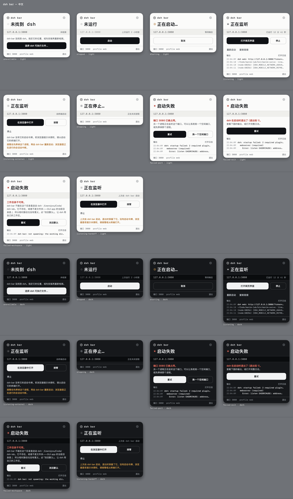
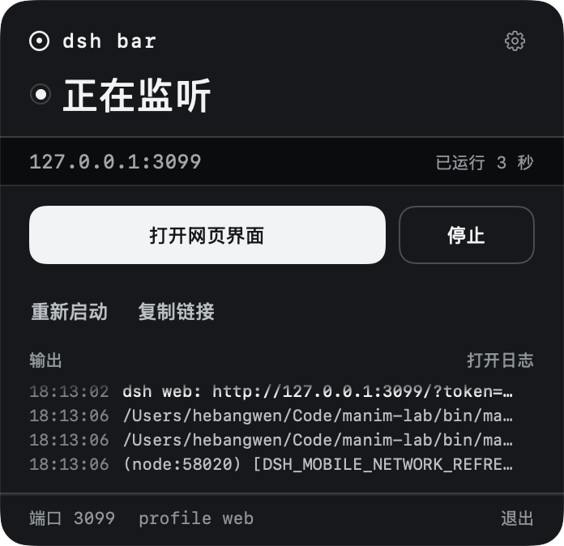
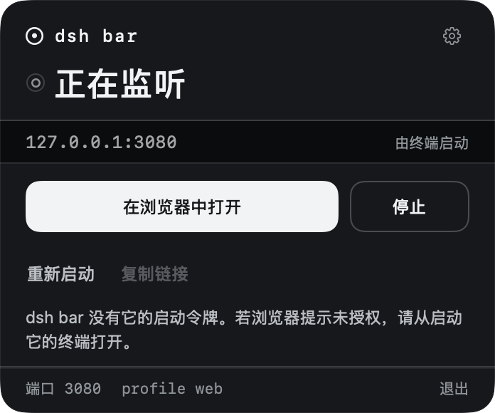
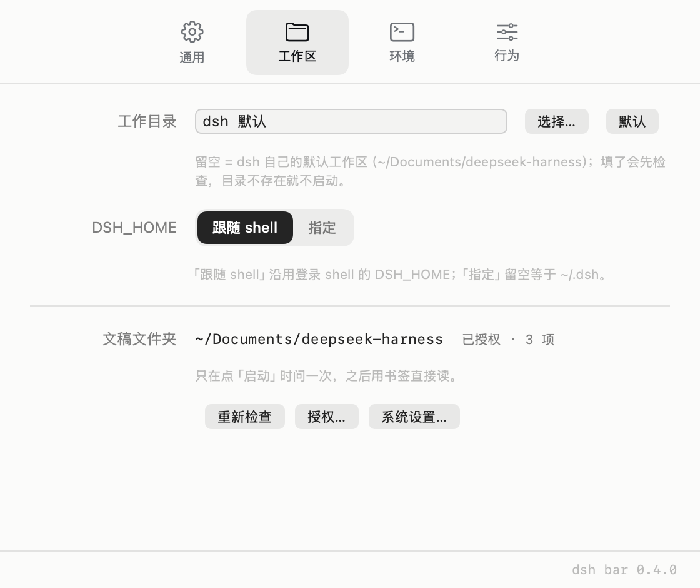
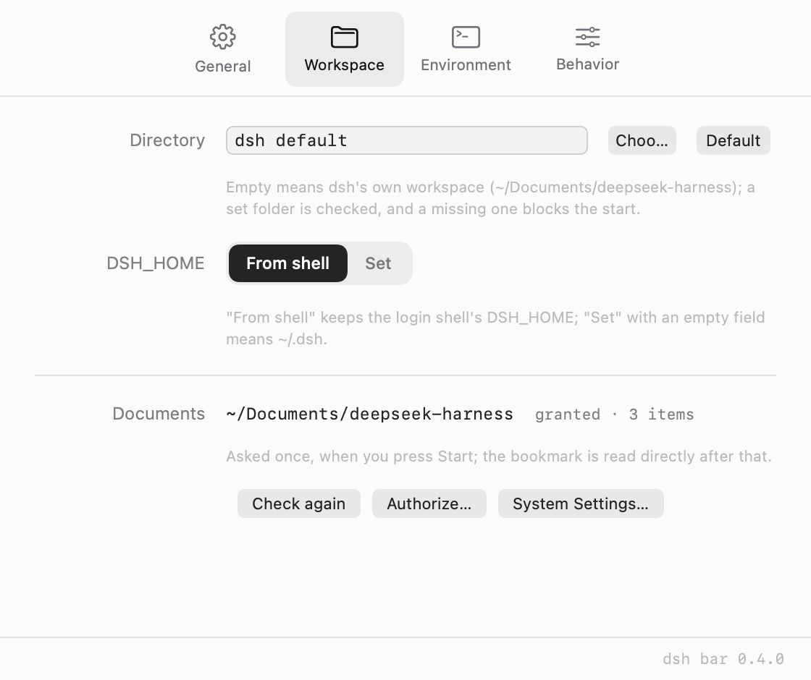
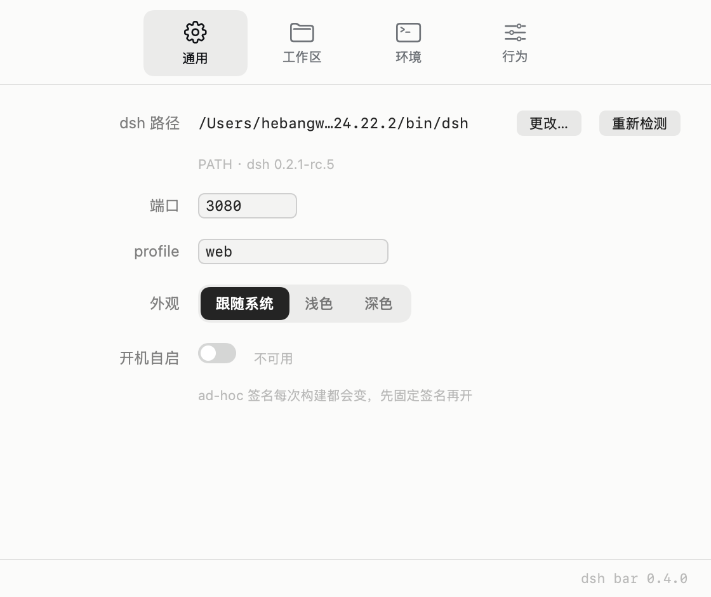
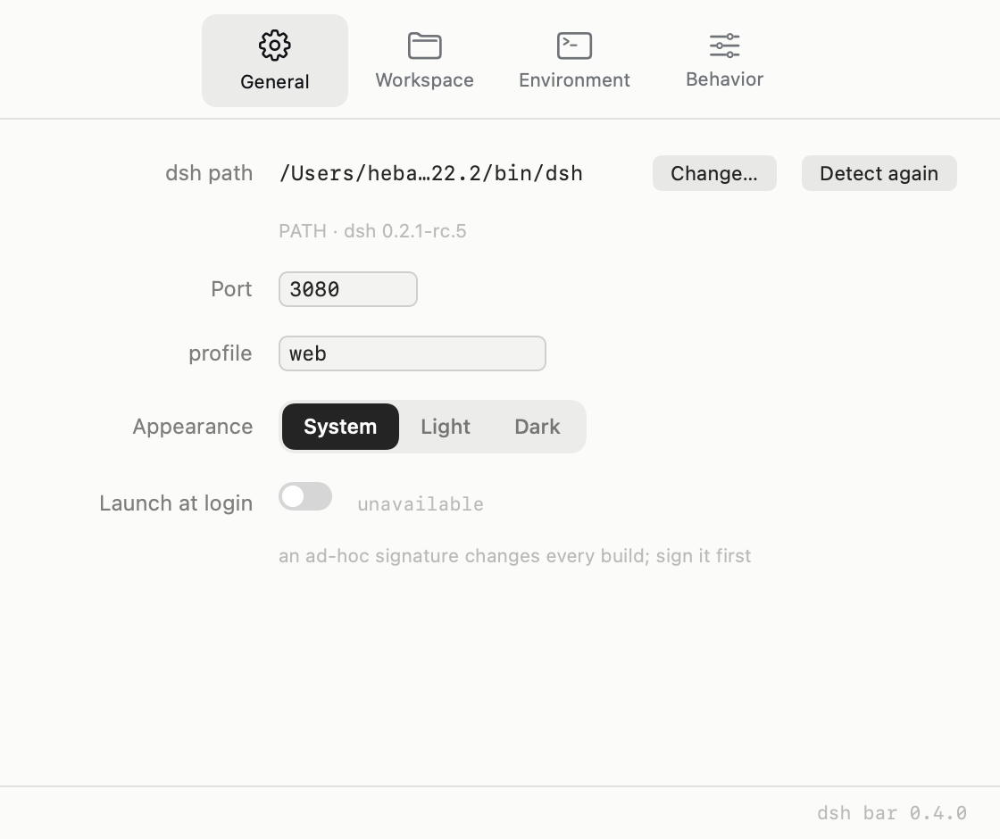
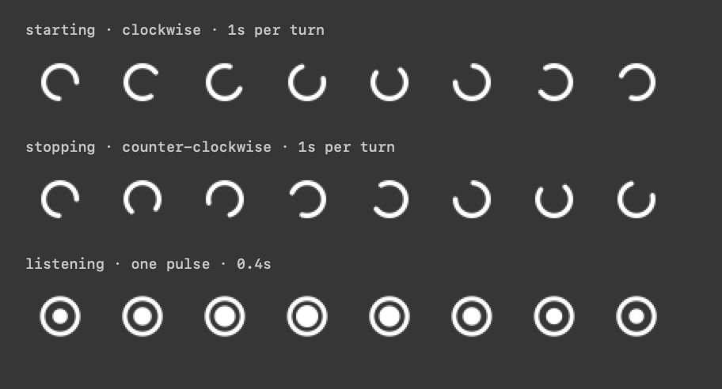

# dsh bar

macOS 菜单栏里的 dsh 管理器：把 `dsh --profile web` 挂在它下面，用面板启动 / 停止 / 重启，并一键进入网页界面。

**当前进度：M3 打磨完成，0.4.0。** 面板、状态、动效、菜单栏图标按设计实现；每个状态都由一个真实的 `dsh --profile web` 进程驱动。M3 把「能跑」补成了「可以每天用」：工作区与 `DSH_HOME`、环境诊断、退出策略（含保留运行时的交接记录）、单实例、全局快捷键、`SMAppService` 开机自启。规划见 [docs/plan/round-3.md](docs/plan/round-3.md)。



英文总览图（同样的场景，英文文案）在 [sheet-en.png](docs/design/sheet-en.png)。

---

## 一眼看清的设计

面板不是一块 dashboard，而是一块**仪器面板**：

- **单色**。DSH 自己的界面就是近黑 + 纸白 + 细线的单色品牌，dsh bar 直接继承它的 token（`#0F1115` / `#61666B` / 10% 细线）。面板里唯一的颜色是"正在变化"（琥珀）和"出错了"（砖红）——颜色只表示语义，从不做装饰。
- **等宽字当英雄字**。状态词（`正在监听` / `Listening`）用系统等宽字体放大到 24–30pt。等宽通常只用来排版小号数据标签，这里反过来，让面板读起来像一张终端打印纸。
- **一条凹槽读数带**。`127.0.0.1:3080` 与运行时长放在一条通栏、比面板略暗的凹槽里，像设备上的显示窗。整块面板只有这一个凹陷面，其余全是"印"在板子上的。
- **刻线分隔**。1px 深线 + 1px 亮线，模仿刻在金属上的线，而不是浮在卡片上的描边。
- **记号同源**。圆环 + 圆点，和 DSH 启动页的细环 spinner 同构；菜单栏图标用同一个环，靠**形状**区分状态（中文界面里也不依赖颜色）。

| 角色 | 浅色 | 深色 |
|---|---|---|
| 面板底 | `#FBFBFA` | `#16181B` |
| 凹槽 | `#EFEFEC` | `#0A0C0E` |
| 墨（主文字 / 主按钮） | `#0F1115` | `#F2F3F4` |
| 次级文字 | `#61666B` | `#B9BEC4` |
| 三级文字 | `#6F7378` | `#8F959B` |
| 过渡（琥珀） | `#A8641A` | `#E0A44A` |
| 失败（砖红） | `#B02A1E` | `#F2705F` |

字体全部使用系统字体（等宽 = SF Mono，界面 = SF Pro，中文回落 PingFang），不打包任何字体文件，避免字体被替换后静默变成别的样子。

## 状态

| 状态 | 状态词 | 指示灯 | 动作 |
|---|---|---|---|
| 未找到 dsh | `未找到 dsh` | 虚线环 | 选择 dsh 可执行文件… |
| 未运行 | `未运行` | 空心环 | 启动 |
| 启动中 | `正在启动…` | 琥珀环 + 呼吸 | 取消 |
| 正在监听 | `正在监听` | 实心点（呼吸）+ 灯座环 | 打开网页界面 / 停止 / 重新启动 / 复制链接 |
| 外部启动 | `正在监听` | 空心内环 | 在浏览器中打开 / 接管（二次确认）/ 停止（二次点击确认） |
| 停止中 | `正在停止…` | 灰环 + 方块 | — |
| 启动失败 | `启动失败` | 砖红点 | 重试 / 换一个空闲端口 + 人话诊断 + 输出 |

界面文案中英双语，跟随系统语言。失败状态按原因分派文案：端口被占、找不到 dsh、进程退出、超时未报地址。

## 控制真实进程

面板上的每个状态都来自一个真实的 `dsh --profile web`：

- **找到 dsh，并让它的 node 也能找到**。GUI 应用的 PATH 只有 `/usr/bin:/bin:/usr/sbin:/sbin`，里面既没有 `node` 也没有 nvm；而 `dsh` 是 `#!/usr/bin/env node` 脚本，从这种环境里跑会直接失败（`env: node: No such file or directory`）。这里有三个必须一起做对的点：
  1. **问交互式登录 shell**。`zsh -lic 'printf <marker>; command env -0'` 才会读 `~/.zshrc`，而 nvm / miniforge / 代理导出一般只写在那里；`zsh -lc` 只读 `.zshenv`/`.zprofile`，拿到的 PATH 里没有 node——这正是之前"点开 app 起不来"的原因。marker 之后的内容才解析，所以 `.zshrc` 的欢迎语和提示符转义污染不了第一个变量。`-lic` 没有 node 时再试 `-lc`，两者都没有才退回进程环境（每次 resolve 都在日志里留一行 `spawn env: … PATH head … node …`）。
  2. **把 dsh 自己的目录放到 PATH 最前面**。`node` 就在 `…/node/v24.22.2/bin/dsh` 旁边，前置这个目录既保证找得到 node，也保证用的是装 dsh 时那个版本，而不是 nvm default alias 指向另一个版本。
  3. **找不到 node 就别装作在启动**。spawn 之前读一次可执行文件的第一行：确实是 `#!/usr/bin/env node` 而 PATH 里没有 node，就不发子进程，直接报「找不到 node。／dsh 是 #!/usr/bin/env node 脚本……检查 ~/.zshrc 里 nvm 的导出」，而不是让面板显示一个 `退出码 127`。
- **检测不等 shell**。`redetect` 只用缓存或进程环境，locator 本来就能从 `~/.nvm/versions/node/*/bin`、Homebrew、`/usr/local/bin` 里把 dsh 找出来，所以面板第一帧不会被一次 1.5 秒的 shell 启动卡住；真正 spawn 前才会阻塞等环境，而那时面板已经写着「正在启动…」。设置里指定的路径最优先，`DSHBAR_DSH_PATH` 次之。
- **先探端口，再启动**。裸 socket `connect()` 之后发一次无 token 的 `GET /`：`401` + `dsh web authentication required` 就是外部 dsh，面板直接显示"正在监听 / 由终端启动"；端口有响应但指纹不对，就是 `端口 N 已被占用。`，不浪费两秒去 spawn 一个注定失败的进程。
- **只认那一行**。就绪信号是 `dsh web: <url>` 且带单个 `token` 参数；stderr 里的插件崩溃、`DSH_MOBILE_NETWORK_*` 警告只进日志，不参与判定。
- **一直在看**。端口不是只在按「启动」时才探测：app 启动后、每次打开面板、改端口之后，以及未运行 / 外部实例状态下每 5 秒，都会探一次。所以终端里起的 dsh 会自己出现在面板上（显示「由终端启动」），终端里 Ctrl-C 掉，面板几秒内也会回到「未运行」。已经由 app 管理的实例不轮询——它的退出有进程回调。
- **接管**。端口上的 dsh 如果是终端启动的，面板给一个明确的「接管」：第一次点击变成「确认接管？」，第二次才动手。接管必须先 `killpg` 掉那个进程，再以受管理的方式在**同一个端口**重新启动，所以浏览器里正在进行的会话会中断——面板用琥珀色把这句话写在按钮下面。停止是另一件事，留在第三行，同样二次确认，两个动作不混。
- **按进程组停止**。`posix_spawn` + `POSIX_SPAWN_SETSID` 让 dsh 自成一组，停止时 `killpg(SIGTERM)` → 5 秒宽限 → `killpg(SIGKILL)`。插件 spawn 的 MCP 子进程会一起收掉，退出 app 时也不会留孤儿。
- **停两种，说明两种**。用户点的停止 → `未运行` + "上次运行 刚刚"；进程自己崩的 → `启动失败` + 退出码。外部实例停止要二次确认，且先 `lsof` 取 pid、确认命令行里确实是 dsh 才发信号。
- **端口 0**。失败时按"换一个空闲端口"把端口设成 0，`dsh --port 0` 由系统分配，真实端口从 URL 回读并写回设置。
- **日志**。`~/Library/Logs/dsh bar/dsh-web.log`：每次启动写分隔头，每行带 `[out]`/`[err]`，超过 1 MB 轮转为 `.1`。面板上的"打开日志"打开的就是它。

失败状态按原因分派：

| 现象 | 面板 |
|---|---|
| 30 秒没打印地址 | `启动失败` + 超时诊断，进程被终止 |
| stderr 出现 `EADDRINUSE` | `端口 N 已被占用。` + 换一个空闲端口 |
| 退出码非 0 | `dsh 在启动时退出了（退出码 N）。` |
| 就绪后崩溃 | 同上，并记下"上次运行 刚刚" |
| 找不到或不可执行 | `找不到或无法执行 dsh。` + 选择可执行文件 |

真实运行（3099，由 app 启动）与外部实例（3080，由终端启动）：




设置窗口有四个页签（通用 / 工作区 / 环境 / 行为）：通用里是 dsh 路径（`更改…` / `重新检测`）、端口（`0` = 自动）、profile、外观与开机自启；工作区里是工作目录、`DSH_HOME` 和文稿文件夹授权。启动时还会异步跑 `dsh --version` 显示版本。演示模式（`DSHBAR_DEMO=1`）保留下来供设计评审，右键的"外观预览状态"子菜单只在演示模式里出现。

## 文稿文件夹权限

dsh 的默认工作区是 `~/Documents/deepseek-harness/default-workspace`，而 macOS 把 `~/Documents` 当受保护目录：没被授权的进程 `opendir` 直接拿 `EPERM`，系统再弹一句"想访问你的文稿文件夹"。dsh 是 dsh bar 的子进程，TCC 把这次访问算在 dsh bar 头上——所以弹窗上写的是 dsh bar，而它每启动一次就来一次。

两个原因叠在一起：

1. **TCC 按代码身份记授权**。`scripts/build-app.sh` 一直是 ad-hoc 签名，每次重编译 cdhash 都变，系统看到的就是"一个从没见过的新 app"，于是重新问。
2. **不授权就起不来**。工作区在读不到时 dsh 只会抛 `EPERM`，看上去像是别的地方坏了。

现在的做法分三层，各管一件事：

| 层 | 做什么 |
|---|---|
| 点「启动」时才问 | 按下启动、而文件夹还没有书签时，app 才用 `NSOpenPanel` 预选 `~/Documents` 让你点一次「授权…」。启动 app、常驻菜单栏、打开设置都不会弹任何对话框——权限只在真正需要它的那一下被要求。用户的选择本身就是系统认的 user intent，不再走系统那句弹窗 |
| 记住它 | 选择存成 security-scoped bookmark（`UserDefaults` 的 `documentsFolderBookmark`），每次启动 `resolve` + `startAccessingSecurityScopedResource()`，spawn 子进程之前再取一次 |
| 不盲读 | 启动时**不**探测文件夹（探测本身就会触发系统弹窗），状态显示「未请求」；只有已存书签或你点「重新检查」时才真的读一次 |

顺手把签名也稳住了：`build-app.sh` 会优先用登录钥匙串里的 Code Signing 证书（`DSHBAR_SIGN_IDENTITY` 指定，或自动取第一个），没有才退回 ad-hoc，并把 cdhash 打出来——换证书前后对比一下就知道系统认的是不是同一个 app。

| 状态词 | 含义 |
|---|---|
| `未请求`（琥珀） | 还没问过，也没读过 |
| `已授权 · 12 项` | 现在读得动，数字是目录项数 |
| `未授权`（砖红） | 系统记着拒绝，或读被拒 |
| `文件夹不存在` | 路径不在（或被 `DSHBAR_DOCUMENTS_FOLDER` 指到了别处） |




读不到的时候，面板输出里会先出现一行 `dsh bar: no read access to ~/Documents …`，而不是等着 dsh 在里面报一个看不懂的 `EPERM`。授权面板取消了也可以继续启动（面板上会留这行说明），dsh 要是真的读不到工作区，失败原因就在输出里。

复位与调试：

```sh
tccutil reset SystemPolicyDocumentsFolder dev.dsh.bar        # 清掉系统里的授权，重新看那一次询问
defaults delete dev.dsh.bar documentsFolderBookmark          # 只删书签（下次点「启动」会重新问）
DSHBAR_DOCUMENTS_FOLDER=/tmp/somewhere ...                   # 换一个目标文件夹，用来看「未请求 / 未授权」两种状态
```

询问只有一个触发点：在面板上按「启动」（失败状态的「重试」和「换一个空闲端口」也走同一条路）。设置里的「授权…」可以随时补授权，不需要等到下一次启动。

## 第三轮：打磨（0.4.0）

六个工作流，验收标准和顺序在 [第三轮规划](docs/plan/round-3.md)；这里是实现后的说明。

### 设置窗口：四个页签

设置不再是“一列往里加”。窗口按通用 / 工作区 / 环境 / 行为四个页签分区，标签右对齐、控件成一列，和大多数 macOS 偏好面板同构：看图不用读，找东西不用滚。




| 页签 | 装什么 |
|---|---|
| **通用** | dsh 路径、端口、profile、外观、开机自启 |
| **工作区** | 工作目录、`DSH_HOME`、文稿文件夹授权 |
| **环境** | 登录 shell 给了什么 + 「重新读取」 |
| **行为** | 退出策略、全局快捷键 |

仓库只留通用 / 工作区两页的图（`sheet-settings-{general,workspace}-{en,zhHans}.png`）；`DSHBAR_SNAPSHOT_SETTINGS` 仍一次写出全部四个页签，需要时再出环境 / 行为。

### 工作区与 `DSH_HOME`

启动 dsh 的两个路径分开管：工作目录是 dsh 找项目的地方，`DSH_HOME` 是它放自己状态的地方。

- **目录留空 = 不传 `chdir`**，让 dsh 用自己的默认工作区。填了就**先检查**：相对路径直接拒绝（GUI app 的当前目录是 `/`，`dsh-lab` 在这里没有意义），不存在或不是文件夹就**不 spawn**——`posix_spawn` 的 chdir 失败会伪装成「找不到可执行文件」，面板宁可说清楚路径。失败状态给「改回默认」这颗按钮。
- **`DSH_HOME` 两档**：「跟随 shell」直接用登录 shell 里的值（默认）；「指定」留空等于 `~/.dsh`，指定了但目录不存在时 app 先 `mkdir -p`——这和 dsh 自己的行为一致，只有「路径存在却是文件」才算错误。
- 每次真实启动都往日志写一行 `launch paths: cwd … · DSH_HOME …`，来源（dsh 默认 / 设置 / 登录 shell / 应用默认）一目了然。

### 环境区块

设置里常显四行：**来源**（交互式登录 shell / 登录 shell（未读 rc）/ 进程环境）、**PATH 前三段**、**node 路径 + 版本**、**这次解析花了多少毫秒**。「重新读取」强制冷解析，绕过 60 秒缓存。

这不是装饰：`#!/usr/bin/env node` 找不到 node 时，面板只会说「找不到 node」，而原因分布在 `~/.zshrc`、nvm、PATH 里。现在没 shell 应答、只有 `-lc` 应答、PATH 里没有 node，三种情况各有一句人话，和日志里的 `spawn env:` 行对得上。

### 退出策略与交接

三档：**停止服务器**（默认，0.3.0 的行为）、**保持运行**、**每次询问**（带「记住我的选择」）。

「保持运行」不是撒手不管：退出时写一条 `HandoffRecord {pid, port, startedAt, launchURL}`。下次启动在端口上看到 dsh 时做**三重校验**——pid 还活着、命令行确实是 dsh、端口指纹还是 dsh——三项全中才在面板上标「上次由 dsh bar 启动」，任一不符就只丢弃记录，**绝不**按记录去杀进程。停止路径没变：`killpg(SIGTERM)` → 5 秒宽限 → `SIGKILL`。

### 单实例与快捷键

- 第二次 `open` 不再长出第二个菜单栏图标：`main.swift` 在任何对象构造之前判定，找到同 bundle id 的实例就发一条 `DistributedNotification` 让它弹面板（失败再 `activate`），然后自己退出。未打包的 `swift run DshBar` 没有 bundle id，永远照常运行，所以调试启动和装好的 app 可以共存。
- 全局快捷键 **⌥⌘D** / **⌃⌥D** / **关闭**，用 Carbon `RegisterEventHotKey`——不需要辅助功能授权，也能在没有任何焦点时收键。注册失败（被别的 app 占了）时设置里红字说明，但**不改写偏好**——占用常常是暂时的（比如另一个副本正在跑），悄悄改掉用户的设置比红字更糟。

### 开机自启

`SMAppService.mainApp`，三态显示：**已开启** / **等待系统批准**（给「打开登录项…」深链）/ **未开启**。不可用时给出原因而不是一个按不动的开关：没在 `.app` 里跑，或者 ad-hoc 签名每次构建都换代码身份——后者同时也是「文稿文件夹每次都问」的根因，`scripts/build-app.sh` 仍然优先用稳定证书。

### 验证

- `dshbar-check`：**297 → 454** 条断言，新增覆盖路径归一化与拒绝、环境报告、交接记录编解码与五种裁决、单实例裁决、快捷键描述符、登录项状态映射，以及每个新状态的中英文案。
- `dshbar-smoke --port 3099`：在**真实 dsh** 上多验一条——记录里的 pid 活着、端口指纹对得上 → `.valid`；SIGTERM 之后同一份记录不再可用。
- 新面板场景 `failed-workspace`、`listening-handoff` 随 `dshbar-snap` 出图（浅/深色 × 中英）。

调试钩子（都只在启动时读一次环境变量）：

| 变量 | 作用 |
|---|---|
| `DSHBAR_ALLOW_SECOND_INSTANCE=1` | 跳过单实例判定，允许第二份 app 同时跑（截图、联调用） |
| `DSHBAR_SKIP_FOLDER_GRANT=1` | 跳过「启动时授权」的模态面板，让脚本能拉起服务器（日志里仍会写明缺授权） |
| `DSHBAR_QUIT_BEHAVIOR=stopManaged\|keepRunning\|ask` | 覆盖退出策略，用来验证「保留运行」这条路径 |

## 动效

菜单栏图标只在「状态真的在变」的时候动；唯一常驻的是监听时的呼吸，因为它要说明的是「还活着」：

| 时机 | 动效 |
|---|---|
| 启动中 | 缺口环顺时针旋转，1.1 秒一圈 |
| 停止中 | 同一个环反向旋转，1.4 秒一圈 |
| 刚刚就绪 | 中心圆点膨胀再收回，一次 0.4 秒 |
| 正在监听 | 中心圆点呼吸：1.0 ↔ 1.26，单程 1.3 秒，一直呼吸 |

正在监听时的呼吸是唯一常驻的动效：它说明服务还活着，而不是说明状态在变。菜单栏里环是静态的模板图、点是一张会缩放的位图，所以只有点在动。面板里的指示灯用同样的节奏（`phaseAnimator`，0.86 ↔ 1.24、1.15 秒），两处看起来是同一台设备。

还有一个踩过的坑：AppKit 给 view 自己的 backing layer 用的是 `(0, 0)` 锚点（坐标系从底左角起算），而 Core Animation 的 `transform.rotation.z` 是绕锚点转的——把旋转直接加到按钮图层上，图标会绕着按钮左下角甩出菜单栏；把按钮图层的锚点改成中心又会被下一次 layout 冲掉。所以过渡态不用按钮自己的图层：启动/停止时插入一个自建的 `CALayer`，里面是一张预先烘焙好的 2x 位图纹理（和静态图标同一支缺口环，半径 5.2、线宽 1.6、265°），锚点天然在中心；颜色按当前菜单栏外观取黑或白，因为模板图的自动着色搬到图层上就没了。旋转因此永远绕图标中心。

实现上踩了两个层级：

1. **不用逐帧换图**。20fps 替换 18pt 图标实测吃 15% CPU（每次赋值都要让状态栏重新排版），改成用 Core Animation 动同一个图层后降到 1% 左右——动效由 WindowServer 合成，主线程零轮询。
2. **动效层不要用 `CAShapeLayer`**。第一版把旋转和呼吸画在矢量图层上，合成器每帧都要重新栅格化路径，实测 app 峰值吃到 14% CPU。现在动效层只吃预先烘焙好的 2x 位图纹理：旋转是纹理变换，缩放是纹理采样，都不重绘。再加 `preferredFrameRateRange` 把呼吸限到 12fps、旋转限到 15fps，实测 app CPU 0.1–0.5%。

顺带一个测量结论：菜单栏动画期间 WindowServer 看起来很高（43–48%），但 A/B/A 对照（无 app / 有呼吸 / 杀掉之后）三次读数一致，说明那是这台机器上的其它负载（Chrome、Web 会话），与 dsh bar 无关。真要核对，请看 `ps -p $(pgrep DshBar) -o %cpu=` 而不是 WindowServer。

就绪那一下仍然用 8 帧换图，因为它是像素级的缩放，0.4 秒后自动停，紧接着接力到呼吸。

打开系统「减少动态效果」后不再有任何运动（含呼吸），静态图形本身已经能区分状态。



## 跑起来

```sh
./scripts/build-app.sh          # 产出 build/dsh bar.app（有 Code Signing 证书就签名，否则 ad-hoc）
open "build/dsh bar.app"        # 菜单栏出现图标，点开就是面板
```

> 默认端口 3080。开发时把端口改成 3099（设置里改，或 `defaults write dev.dsh.bar dshPort -int 3099`），不要动 3080 上正在运行的会话。

开发与验证：

```sh
swift run dshbar-check                            # 454 项校验：文案、状态谓词、解析、状态机、fixture、图标帧、文件夹权限、node/PATH
swift run dshbar-smoke --port 3099                # 真机端到端：定位 → node 可解析 → 启动 → 校验 URL/401 → 停止 → 端口释放
swift run dshbar-smoke --external --port 3099     # 接管前半段：lsof 找 pid → ps 校验命令行 → SIGTERM → 端口释放
swift run dshbar-snap docs/design                 # 离屏渲染所有状态 → PNG（浅/深 × 中/英）
DSHBAR_OPEN_PANEL=1 "build/dsh bar.app/Contents/MacOS/DshBar"   # 启动即弹面板
DSHBAR_AUTOSTART=1 ...                                           # 启动后立即 start（联调用，省一次点击）
DSHBAR_AUTORESTART=1 ...                                         # 再等 9 秒按一次"重新启动"
DSHBAR_STATE=failedPort DSHBAR_OPEN_PANEL=1 ...                  # 指定预览状态启动
DSHBAR_OPEN_SETTINGS=1 ...                                       # 直接打开设置窗口
DSHBAR_SNAPSHOT_WINDOW=/tmp/panel.png ...                        # 把窗口自己绘制的内容存成 PNG
DSHBAR_SNAPSHOT_DELAY=6 DSHBAR_SNAPSHOT_WINDOW=...               # 等状态稳定后再截图
DSHBAR_SNAPSHOT_SETTINGS=/tmp/settings.png ...                   # 离屏渲染设置窗口：settings.png + settings-{workspace,environment,behavior}.png
DSHBAR_SNAPSHOT_DARK=1 ...                                       # 设置页快照连深色一起出
DSHBAR_ALLOW_SECOND_INSTANCE=1 ...                               # 跳过单实例判定，跑第二份 app（截图/联调）
DSHBAR_SKIP_FOLDER_GRANT=1 ...                                   # 跳过启动时的授权模态，脚本也能拉起服务器
DSHBAR_QUIT_BEHAVIOR=keepRunning ...                             # 覆盖退出策略：验证「保留运行」
DSHBAR_DEMO=1 ...                                                # 演示模式：状态由 fixture 驱动
```

右键菜单栏图标可直接跳到 10 个预览状态，用来检查排版。菜单栏图标（浅色 / 深色菜单栏两种底）单独出图在 `docs/design/sheet-menu-bar-icons.png`。

## 结构

```
Sources/DshBarKit/            可测的设计系统 + 领域模型 + 纯逻辑（无 AppKit 视图）
  Design/Theme.swift          色板、字阶、间距（浅/深两套）
  Design/Components.swift     环状指示灯、刻线、按钮样式、输出尾、诊断块
  Design/PanelView.swift      纯展示：吃 HarnessSnapshot，吐面板
  Design/StatusIcon.swift     菜单栏 template 图标（按状态画形状）
  Model/HarnessSnapshot.swift 状态枚举 + 面板所需的全部值
  Model/Fixtures.swift        10 个预览场景（同时驱动 demo 与出图）
  Localization/Copy.swift     中英文案与时长/诊断格式化
  Live/HarnessReducer.swift   纯状态机：事件 → 新状态 + 副作用命令
  Live/LaunchOutput.swift     `dsh web:` 行解析、EADDRINUSE 与启动失败分类
  Live/DshLocator.swift       候选路径顺序与可执行性判定
  Live/LoginShellEnvironment.swift  登录 shell 环境抓取、解析、清洗
  Live/PortProbe.swift        端口探测与 dsh 指纹
  Live/LogBuffer.swift        40 行环形日志 + 强调规则
  Live/BarPreferences.swift   路径 / 端口 / profile 的持久化
  Live/ChildProcess.swift     posix_spawn + SETSID + 逐行读取 + 按组收发信号
  Live/ExternalInstance.swift lsof/ps 找外部实例、校验后停止
  Live/LaunchTarget.swift     工作目录与 DSH_HOME 的解析和拒绝理由
  Live/EnvironmentReport.swift 登录 shell 给了什么（来源 / PATH / node / 耗时）
  Live/Handoff.swift          保留运行时留下的记录，以及下次启动怎么验它
  Live/QuitBehavior.swift     退出三档
  Live/SingleInstance.swift   第二份 app 让位给第一份
  Live/HotKeyChoice.swift     ⌥⌘D / ⌃⌥D / 关闭的描述符
  Live/LaunchAtLogin.swift    SMAppService 状态映射与稳定签名判断
Sources/DshBar/               菜单栏 app：NSStatusItem + NSPanel + SwiftUI
  HarnessModel.swift          唯一的 ObservableObject：面板状态 + 动作
  LiveBackend.swift           真实副作用：环境、定位、spawn、超时、日志落盘
  HotKeyCenter.swift          Carbon 热键注册与事件回调
  DemoBackend.swift           演示驱动（fixture 状态，供设计评审）
Sources/DshBarSnapshot/       离屏出图工具（ImageRenderer → PNG）
Sources/DshBarSmoke/          真机端到端验证（启动 → 校验 → 停止）
Sources/DshBarCheck/          454 项断言的可执行检查（不依赖 XCTest / Xcode）
scripts/                      build-app.sh / make-icon.swift
docs/design/                  外观图（评审用）
docs/plan/                    轮次规划（round-3.md = M3 打磨 → 0.4.0）
```

面板本身是 `NSPanel`（隐藏标题栏、可成为 key window）+ `NSHostingView`，所以 Esc 关闭、按钮点击、VoiceOver 都按原生窗口工作；高度由内容决定，跟随图标下方、按屏幕边缘夹取。

## 下一步

- **M4 多实例**：现在一个 app 只跟一个 dsh；下一步是多个 profile / 端口并存，面板列出来分别启动与停止。附带日志面板（不离开面板就能翻 `LogBuffer`）和「导出诊断」（环境报告 + 最近日志一次打包）。
- 第三轮的取舍留在 [docs/plan/round-3.md](docs/plan/round-3.md) 末尾，改动前值得读一眼。
- 想恢复 `swift test` 的话，把 `DshBarCheck` 里的断言搬回 test target 即可。

> 联调请用 **3099** 之类的端口，不要动 3080 上正在运行的会话。

## 为什么没有 XCTest

这台机器只装了 Command Line Tools，而 CLT 不包含 XCTest / Swift Testing 模块，`swift test` 会直接报 `no such module 'XCTest'`。所以断言放在一个普通可执行 target 里：`swift run dshbar-check`，不依赖 Xcode，失败时返回非零退出码。等装回 Xcode 后想恢复 `swift test`，把这些断言搬回 test target 即可。
